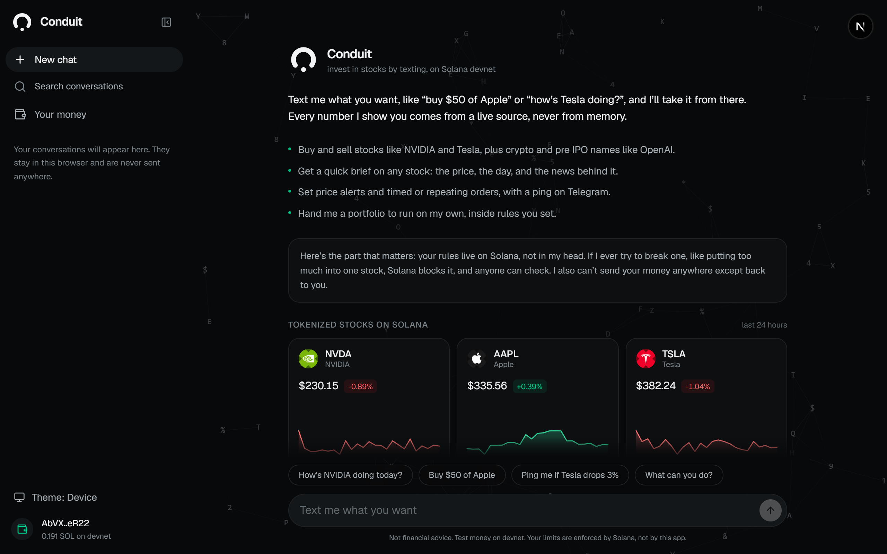
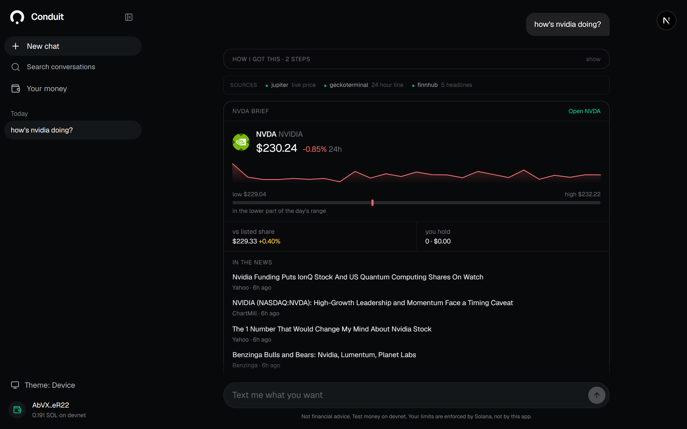
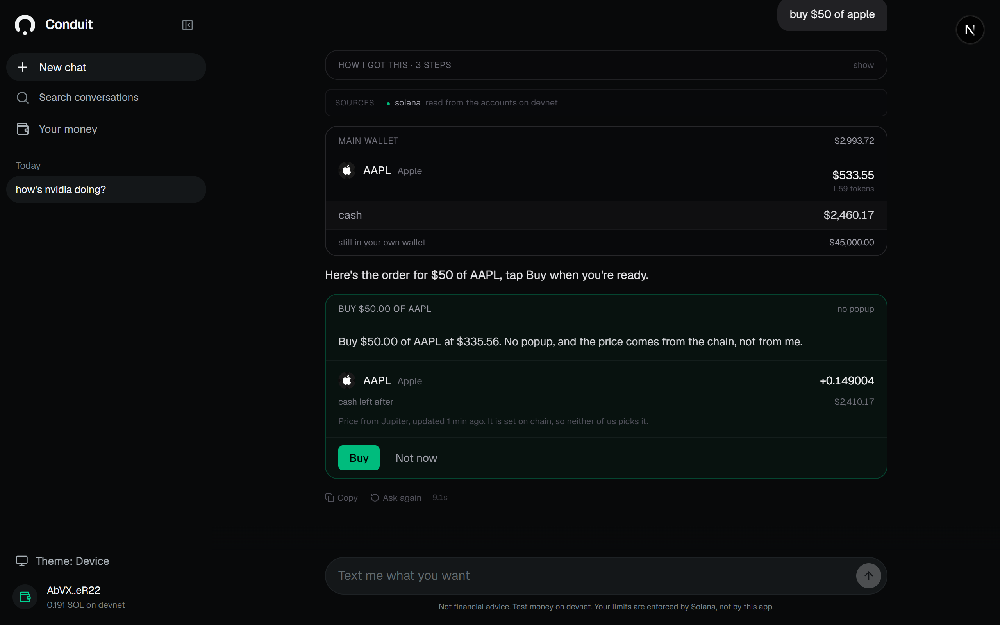
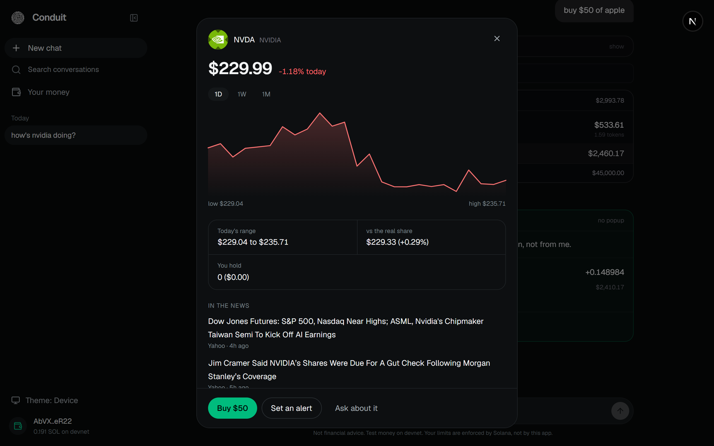
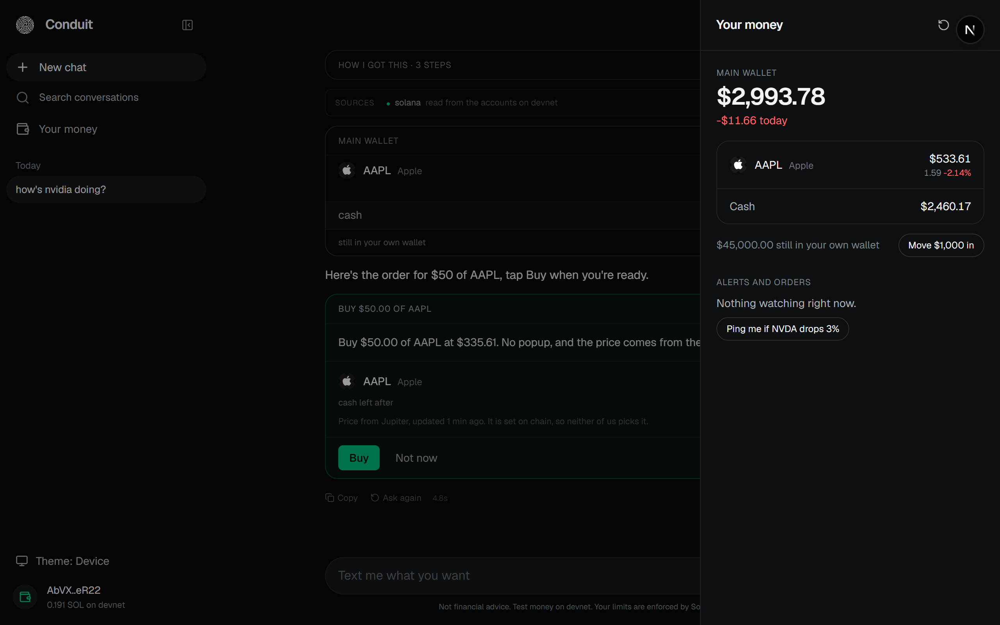
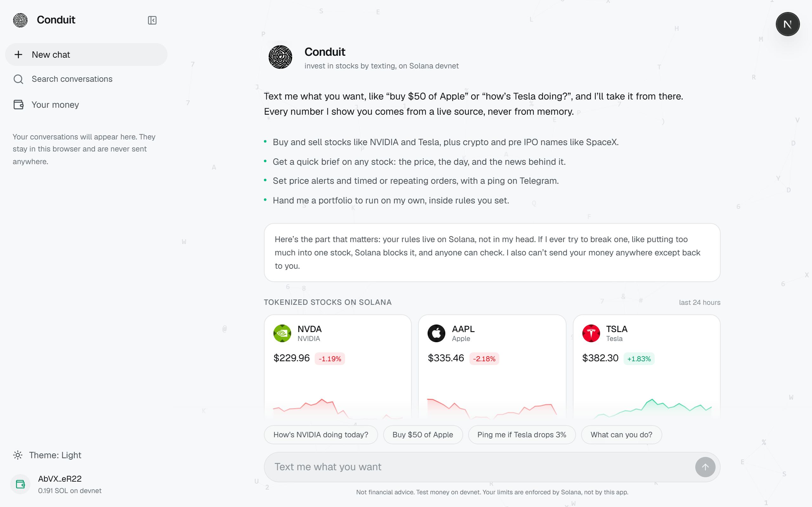
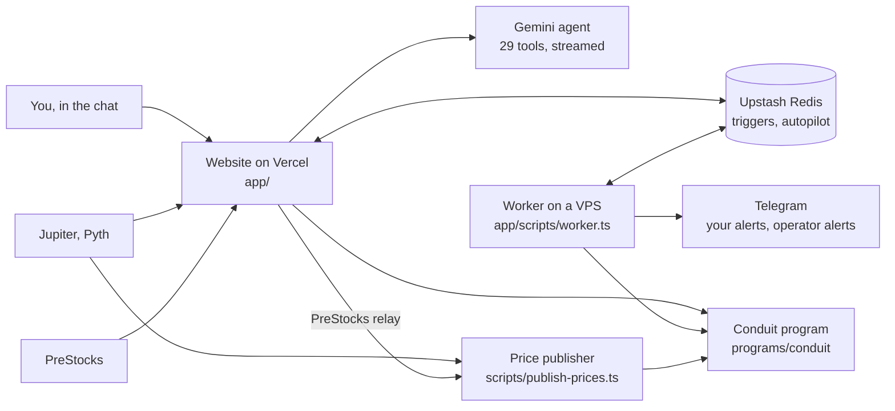

# Conduit

**Invest in stocks the way you text a friend.** Type "buy $50 of Apple" or "ping me if Tesla drops 3%", and an AI agent does it on Solana, inside limits that a Solana program enforces and the agent cannot change.

[Live app](https://ai-conduit.vercel.app) · [Program on Solana Explorer](https://explorer.solana.com/address/6X7wfnLNHQvW94CHPVFdguraojh5uEN3Y1gjfi2pkxVu?cluster=devnet) · [A refusal on chain](https://explorer.solana.com/tx/4uo7FtZtCNurZRmQ6sn5F64n8H7wEJRDUPq8BKtadjqsNBcXfbAviwkWSPpcNvQWwus1EmeiHdu17UJaHPiRFmmF?cluster=devnet) · [Live health check](https://ai-conduit.vercel.app/api/health) · [Proof table](#proof-you-can-click)



Submitted to the **Colosseum Crypto World's Fair**. Built on **Solana** with **PreStocks**, **Pyth** and **Jupiter**: tokenized stocks, crypto and pre IPO companies, in one conversation, on devnet.

|      29     |           15          |       28       |          18         |             5            |       474       |
| :---------: | :-------------------: | :------------: | :-----------------: | :----------------------: | :-------------: |
| agent tools | on chain instructions | named refusals | assets in 3 classes | AI analysts per decision | automated tests |

## The problem

Trading apps are built like airplane cockpits: order tickets, charts, tabs and panels stacked on top of each other. Someone who wants "a bit more Apple" has to learn the whole cockpit first, and many never do. That same person sends dozens of messages a day. Messaging is the one interface nobody has to learn.

So Conduit asks two questions:

1. **What if investing felt like sending a message?** You say what you want, in your own words, and get a clear card back to approve.
2. **What if the assistant could keep working after you close the tab,** buying on a schedule, watching a price, running a portfolio, **without asking you to trust it blindly?**

The second one is the hard one. An AI that can move money is only useful if it cannot misuse that power. Conduit's answer: **the AI never holds the rules.** They live in a Solana program, and the program checks every move the AI makes.

## What you can say to it

Every line below works in the live app. Anything that moves money comes back as a card you approve with one tap.

| You type                                                  | What happens                                                                                     |
| --------------------------------------------------------- | ------------------------------------------------------------------------------------------------ |
| `how's NVIDIA doing?`                                     | A stock brief: price, the day's move, a 24 hour chart, the gap to the real share, the headlines  |
| `buy $50 of Apple`                                        | A trade card with the exact tokens you get and the on chain price. Tap Buy and it settles        |
| `in 2 minutes, buy $50 of AAPL`                           | A timed order: it waits, then buys at that moment's price                                        |
| `buy $20 of AAPL every 10 minutes`                        | A repeating order. The card shows the most it can ever spend                                     |
| `ping me if Tesla drops 3%`                               | A price alert, with a Telegram ping when it fires                                                |
| `put $5,000 to work, max 30% in any stock, keep 10% cash` | A **mandate**: your rules, written into a Solana account you sign                                |
| `analyze NVDA, TSLA and OpenAI`                           | Five AI analysts (Research, Bull, Bear, Risk, Manager) propose a split, with a reason for each   |
| `put it on autopilot, keep pre IPO under 10%`             | The agent runs the portfolio on a schedule, inside the mandate                                   |
| `how am I doing against the market?`                      | A scorecard against simply holding SPY                                                           |

<p>
  
  
</p>

## What it feels like to use

Since the first version, most of the work went into making Conduit feel like texting a person rather than operating a terminal.

* **Answers stream in** word by word, with the steps it is taking shown as it takes them.
* **It talks like a friend.** Short replies, everyday words, small talk for small talk. It names the button on the card word for word ("tap Buy when you're ready") and may not say "done" until the card reports it.
* **Cards say who signs.** "no popup" when the agent signs from your main wallet, "you'll sign in your wallet" when you do, "free test money" for the faucet.
* **It shows its work.** "How I got this" opens every tool it used, and a sources strip names where each figure came from: Solana, Jupiter, PreStocks, Pyth, GeckoTerminal or the news service.
* **Next step chips, Copy and Ask again** under every answer, with the time it took.
* **A page for every stock.** Tap a stock anywhere: 1 day, 1 week and 1 month charts, today's range, the token's gap to the real share, what you hold, the news, and Buy $50, Set an alert or Ask about it.
* **Your money in one panel.** The main wallet's total and today's change, each holding's move, cash, what is still in your own wallet, and every alert and order being watched.
* **Light and dark themes** that follow your device, and a layout that works on a phone.

<p>
  
  
</p>

<details>
<summary><b>The light theme</b></summary>



</details>

## Why this needs Solana

Conduit is not a chatbot bolted onto a brokerage. **The Solana program is the trust boundary.** Remove it and the product stops being safe to automate.

* **The limits are an account, not a prompt.** A mandate stores its largest position, minimum cash, maximum turnover per rebalance, maximum number of assets and the only assets allowed. The agent's one power over it is `propose_rebalance`, and the program re-checks every limit first. A breach fails with the rule it broke, for example [`PositionExceedsMaxSize`](https://explorer.solana.com/tx/4uo7FtZtCNurZRmQ6sn5F64n8H7wEJRDUPq8BKtadjqsNBcXfbAviwkWSPpcNvQWwus1EmeiHdu17UJaHPiRFmmF?cluster=devnet).
* **The agent can act without a popup, and still cannot escape.** From your main wallet, money can go three places only: to the trading desk at the on chain price, into your own mandates, or back to you. Pulling money out of a mandate is `move_from_mandate`, and the program lets **only the owner** sign it.
* **The agent never sets a price.** `trade` and `settle` read the price from an account bound to each asset. Prices older than 10 minutes are refused, and rounding always goes against the wallet, never the desk.
* **Cheap, fast transactions make per trade checks practical.** Every order, trigger run and autopilot cycle is its own checked transaction. A 7 asset settlement fits in one transaction through an [address lookup table](https://explorer.solana.com/address/2Pdn523kthmjy6zqEuGwGcVHxRrzZSmGgLj85zEbxUVM?cluster=devnet) of 58 addresses.

## How it works



1. **You type.** The chat streams your message to `/api/chat`, where a Gemini agent picks from 29 tools, over up to 6 rounds and 10 tool calls, and the reply streams back as it is written.
2. **Anything that moves money becomes a card.** Nothing runs until you tap it.
3. **The program checks it.** A trade, a proposal or a settlement is a Solana transaction the program accepts, or refuses by name.
4. **The worker keeps going when you leave.** Every minute it checks triggers and due autopilot cycles, and it reports each outcome to your Telegram.
5. **Prices stay fresh on chain.** The publisher writes every price every 4 minutes, because the program refuses anything older than 10.
6. **Something watches all of it.** Every 5 minutes the worker checks the store, every on chain price, the SOL in each key and the Telegram listener. A problem reaches the operator's Telegram once, again every 6 hours while it lasts, and once more when it recovers. [`/api/health`](https://ai-conduit.vercel.app/api/health) answers the same question for anyone, live.

<details>
<summary><b>The Solana program: 15 instructions</b></summary>

| Job                                  | Instructions                                                                                                          |
| ------------------------------------ | --------------------------------------------------------------------------------------------------------------------- |
| Mandates                             | `initialize_mandate`, `initialize_portfolio`, `set_mandate_status` (pause, resume, close)                             |
| The agent's one power over a mandate | `propose_rebalance`                                                                                                   |
| Making an approved allocation real   | `settle` (the portfolio is valued from actual token balances, at on chain prices)                                     |
| Main wallet                          | `open_wallet`, `trade`, `withdraw`                                                                                    |
| Moving money                         | `move_to_mandate` (owner or agent), `move_from_mandate` (**owner only**), `withdraw_from_mandate` (to the owner only) |
| Prices and desk                      | `initialize_desk`, `register_desk_asset`, `initialize_publisher`, `publish_price`                                     |

28 error codes (6000 to 6027), one per rule, so every refusal names the rule it broke. Program id `6X7wfnLNHQvW94CHPVFdguraojh5uEN3Y1gjfi2pkxVu` on devnet.

</details>

<details>
<summary><b>The autopilot, the safety brake and triggers</b></summary>

* **The committee.** Research reads the market. Bull and Bear argue opposite sides **at the same time and never see each other's answer**, so the manager weighs two independent views rather than a compromise. Risk applies your limits and the Portfolio Manager decides a split, with a thesis per position. Every stage's output is schema checked ([`pipeline.ts`](app/src/lib/agents/pipeline.ts)).
* **The brake.** If the portfolio falls a set amount from its best point (10% by default), the autopilot moves toward cash and stops itself. Proven live: tripped, moved to cash in 2 transactions, paused.
* **The scorecard.** Performance against simply holding SPY, with deposits and withdrawals kept out of the result.
* **Triggers** ([`app/src/lib/triggers/`](app/src/lib/triggers/)): rise or fall by a percent, cross a price, "in 2 minutes", or every N minutes with or without a price rule, capped at a run count. A trigger is claimed before it trades, so it can never fire twice. A failed trade stops a repeating order instead of retrying it every interval, and after downtime the schedule restarts from now, with no burst of catch up trades.

</details>

<details>
<summary><b>More of what the agent does</b></summary>

* **It fixes the gap instead of failing.** Ask for a $500 buy with $50 in your main wallet and it prepares a deposit card for the $450 shortfall, then carries on with the buy once you approve, without asking again ([`wallet-tools.ts`](app/src/lib/copilot/wallet-tools.ts)).
* **It knows the program's answer first.** `check_proposal` runs a line for line mirror of the program's rule check ([`proposal.ts`](app/src/lib/proposal.ts)) and names the exact on chain error a proposal would hit. If you send it anyway, the program refuses it on chain, where anyone can check.
* **Its memory is the blockchain.** `get_history` rebuilds a mandate's history from Solana transactions ([`events.ts`](app/src/lib/events.ts)), every accepted rebalance and every refusal, so it cannot drift from what happened.
* **Every number comes from a tool.** The first rule in [`loop.ts`](app/src/lib/copilot/loop.ts): a figure it states must come from a tool call in this conversation. If a price could not be fetched, it says so.
* **Research, not advice.** It explains and offers. It never tells you to buy or sell, and says it is not a licensed adviser.
* **It meets you where you are.** Say "hi" and it greets you for your stage: not connected, brand new, ready, or holding. Conversations stay in your own browser, searchable from the sidebar.
* **Telegram you can trust.** You link a chat by signing a message with your wallet, so nobody else can claim your alerts.

</details>

## Technical highlights

* **Streaming that never takes a word back.** Every reply passes through a style fixer ([`style.ts`](app/src/lib/copilot/style.ts)) that rewrites dashes and list numbering. A word already on screen cannot be rewritten, so [`prose-stream.ts`](app/src/lib/copilot/prose-stream.ts) holds back only the short tail a later character could still change. The agent can still withdraw narration that turned out wrong, such as a card it claimed before the card existed.
* **An AI provider that fails often, handled.** During the build, whole Gemini model families returned 404, 429 and 503. [`gemini.ts`](app/src/lib/gemini.ts) walks a ladder of three models, drops one that has not started writing within 10 seconds, rests a busy model for 15 seconds and an out of quota one for 60, and keeps Gemini's thought signatures intact across tool calls.
* **A price is never republished as fresh.** PreStocks' firewall refuses our server, so the publisher reads PreStocks through the site's `/api/prices`, refuses any quote observed more than 120 seconds ago, and writes the time the price was **observed**, not the time it was published. The program's 10 minute rule then means what it says.
* **Knowing when it is broken.** Written after the store refused every command for a day and a half while the worker's log said "alive". [`app/src/lib/ops/`](app/src/lib/ops/) names each failure in plain words (stale prices warn at 8 minutes, before the program's 10 minute refusal), and the alert book tells the operator once, reminds, and says when it is over.

## Sponsor integrations

| Technology          | Role in Conduit                                                                                                                         | Where                                                                                                                          |
| ------------------- | --------------------------------------------------------------------------------------------------------------------------------------- | ------------------------------------------------------------------------------------------------------------------------------ |
| **PreStocks**       | The whole pre IPO sleeve: the companies, their prices, and a strategy built on the gap between token price and company mark            | [`app/src/lib/prestocks.ts`](app/src/lib/prestocks.ts), [`app/src/lib/autopilot/pre-ipo.ts`](app/src/lib/autopilot/pre-ipo.ts) |
| **Pyth**            | Crypto prices for the agent (Hermes), a native on chain Pyth price parser in the program, and the feed id that identifies every asset   | [`app/src/lib/pyth.ts`](app/src/lib/pyth.ts), [`programs/conduit/src/settlement.rs`](programs/conduit/src/settlement.rs)       |
| **Solana** (Anchor) | The rule keeper: 15 instructions, 28 named errors, custody and settlement                                                               | [`programs/conduit/src/`](programs/conduit/src/)                                                                               |
| **Jupiter**         | Real xStock trade prices for the 7 tokenized equities                                                                                   | [`app/src/lib/jupiter.ts`](app/src/lib/jupiter.ts)                                                                             |

### PreStocks: a strategy, not a price list

PreStocks publishes two prices for each private company: `tokenPrice`, what the token trades at, and `markPrice`, what the company exposure behind it is valued at. Conduit treats the gap as the signal. The autopilot **buys** a name 10% or more below its mark, **adds nothing** to one 15% or more above, **trims** one 30% or more above, and caps the pre IPO share of the portfolio (10% by default). On devnet it did exactly that: it bought SpaceX at $116.99 against a $148.81 mark (21% below), stayed out of OpenAI at a 31% premium, and settled on chain in mandate [`65rLrw95...`](https://explorer.solana.com/address/65rLrw95HrPPqAnmDobG1qkG1cLjQwRaWKRMukhJeJiz?cluster=devnet).

PreStocks has since stopped listing SpaceX. Conduit does not paper over that: the publisher writes no price it cannot observe, the program refuses trades on the stale one, and the health check reports it. The other 7 pre IPO names are priced live.

### Pyth: built into the price layer

Every asset in the registry is identified by its Pyth feed id, and the program's price reader (`price_from` in [`lib.rs`](programs/conduit/src/lib.rs)) decides who to trust **by who owns the price account**. An account owned by the Pyth receiver is parsed natively (`read_price`, tested against a real 134 byte devnet Pyth account). An account written by Conduit's publisher is read as a published price. Anything else is refused with `UnknownPriceSource`. Moving an asset onto a live Pyth feed is a registry change, not a code change. In the app, Pyth Hermes prices BTC, ETH and SOL through a server side proxy, so the key never reaches the browser.

Pyth's equity feeds refused our key with `Not entitled` (a commercial tier), and a batch with one refused feed fails completely, so [`pyth.ts`](app/src/lib/pyth.ts) retries feeds one by one to isolate the refusal, and equities moved to Jupiter's xStock trades. On TSLA, the one equity feed we could read, Pyth said 376.17 and Jupiter 376.30, about 3.5 basis points apart.

## Proof you can click

| What                                                           | Evidence                                                                                                                                                |
| -------------------------------------------------------------- | ------------------------------------------------------------------------------------------------------------------------------------------------------- |
| The live app                                                   | [ai-conduit.vercel.app](https://ai-conduit.vercel.app)                                                                                                  |
| Its health, live (today it reports the SpaceX price as stale)  | [/api/health](https://ai-conduit.vercel.app/api/health)                                                                                                 |
| The deployed program                                           | [`6X7wfnLN...`](https://explorer.solana.com/address/6X7wfnLNHQvW94CHPVFdguraojh5uEN3Y1gjfi2pkxVu?cluster=devnet)                                        |
| A main wallet trade, signed by the agent                       | [`48ymYD9C...`](https://explorer.solana.com/tx/48ymYD9C5gQiigMnQv8Z5WBU9vw2pgmu5m6y22wAEnyg4aLCbwdn88ybvFwbbHvpphYHNGLCMWTYkNmtrHd8faqc?cluster=devnet) |
| A rebalance the program accepted                               | [`3PY2rYUh...`](https://explorer.solana.com/tx/3PY2rYUhtiWCPrR6gdiDpdALHMbKDKMDUbrNxCFryUgmBRuo458mYATepv7UdWZ5GaY6KW4Wx3h4CPNvsP8igxfb?cluster=devnet) |
| A rebalance the program **refused** (`PositionExceedsMaxSize`) | [`4uo7FtZt...`](https://explorer.solana.com/tx/4uo7FtZtCNurZRmQ6sn5F64n8H7wEJRDUPq8BKtadjqsNBcXfbAviwkWSPpcNvQWwus1EmeiHdu17UJaHPiRFmmF?cluster=devnet) |
| A settlement into real token balances                          | [`5pW7hZTR...`](https://explorer.solana.com/tx/5pW7hZTRtGwUjZfy8eV9R4h4AULmMR3LVC1K9wk1XTxvbH6Wm2KJrQZCyRVajnNSwCKstfh7happWWPVPLzjDYNF?cluster=devnet) |
| Money moved into a mandate                                     | [`3XHLZZgB...`](https://explorer.solana.com/tx/3XHLZZgBvg5LbDKeS8DCgQP7RaydW7Nz2zoZNMgzt7u3WYkhagmjonDgnMM3sMvx8VtatoP2vkv6yYpVUWvxMFCe?cluster=devnet) |
| A withdrawal from a mandate back to its owner                  | [`62LRLWRh...`](https://explorer.solana.com/tx/62LRLWRhoBZ2DkxkfFgdDwt43fXvCr9pWhQxFgspajZNhhkVNmNRHkPwjKYTc81SEk8pP9CUVgm42Gq2ts3mWJcj?cluster=devnet) |
| The pre IPO autopilot mandate (SpaceX bought below mark)       | [`65rLrw95...`](https://explorer.solana.com/address/65rLrw95HrPPqAnmDobG1qkG1cLjQwRaWKRMukhJeJiz?cluster=devnet)                                        |

## Tested

**474 automated tests, all passing:** 53 Rust unit tests (policy, settlement arithmetic, the Pyth parser), 77 TypeScript integration tests against the live devnet program (balances checked on both sides of a settlement), and 344 app tests. The Rust and app suites were rerun on 10 October 2026.

On top of that, **74 recorded test runs with 877 hand checks**, many live on devnet, in Chrome and against the deployed site. They found 131 failures. One is still open today, the SpaceX price, listed under the limitations below. A few of the others:

| Run                          | What it proved or caught                                                                                                                           |
| ---------------------------- | -------------------------------------------------------------------------------------------------------------------------------------------------- |
| Wallet and RPC proxy         | The proxy refuses 6 kinds of bad request, including a blocked method hidden in a batch. The built bundle holds no Pyth key, Gemini key or RPC URL |
| Pre IPO strategy, live       | The first cycle hit Solana's transaction size limit (1333 of 1232 bytes). Fixed with the lookup table; the second settled with no manual step     |
| Safety brake, live           | The first trip failed to reach cash. Fixed, and it tripped, went to cash in 2 transactions and paused itself                                       |
| Friend voice, live model     | The AI said "Tap Approve" on a card whose button said "Open it". Each card now hands the model its button label, and it names it word for word     |
| Store limit, live            | The shared store hit its plan limit and every job stopped while the log said "alive". That led to the health checks and operator alerts           |
| PreStocks relay              | The first relay returned no prices because the site had cached a PreStocks failure. Failures are no longer cached                                 |

## Try it

**On the live app (about 2 minutes):**

1. Install Phantom and switch it to **Devnet** (Settings, Developer settings). Get a little devnet SOL at [faucet.solana.com](https://faucet.solana.com) for the few steps you sign yourself.
2. Open [ai-conduit.vercel.app](https://ai-conduit.vercel.app) and connect.
3. Type `give me demo cash`, then `open my main wallet`, then `deposit $1,000`.
4. Type `buy $50 of Apple`, then tap Buy.
5. Tap any stock for its page, or open **Your money** in the sidebar.
6. Try `ping me if Tesla drops 3%`, or `put it on autopilot`.

**Locally:**

```bash
git clone https://github.com/MikeMoulder/Conduit.git && cd Conduit/app
cp .env.example .env     # fill in the keys below
npm install
npm run agent:keypair    # creates the agent key and writes it to .env
npm run dev              # http://localhost:3000
npm test                 # 344 app tests
```

Requires Node 20.6 or later. The program is already deployed on devnet, so the app runs against it as is.

| Variable                                  | What it is                                                     | Where to get one                                                                                                    |
| ----------------------------------------- | -------------------------------------------------------------- | ------------------------------------------------------------------------------------------------------------------- |
| `GEMINI_API_KEY`                          | The agent's model                                              | [aistudio.google.com/apikey](https://aistudio.google.com/apikey), free                                              |
| `PYTH_API_KEY`                            | Hermes prices for crypto                                       | [pythdata.app](https://pythdata.app), free                                                                          |
| `AGENT_SECRET_KEY`                        | The agent's signing key                                        | `npm run agent:keypair`                                                                                             |
| `FAUCET_SECRET_KEY`                       | Pays fees for agent signed actions, and hands out demo cash    | Any devnet keypair with a little SOL. Demo cash comes only from our faucet, so the full flow is quickest live       |
| `SOLANA_RPC_URL`                          | Devnet RPC                                                     | The public endpoint works; a dedicated one is faster                                                                |
| `UPSTASH_REDIS_REST_URL`, `_TOKEN`        | Optional: the store shared by the site and the worker          | [console.upstash.com](https://console.upstash.com), free. Without it, a local JSON file is used                    |
| `TELEGRAM_BOT_TOKEN`, `FINNHUB_API_KEY`   | Optional: the bot, and company news                            | @BotFather on Telegram; [finnhub.io](https://finnhub.io), free                                                      |
| `OPS_TELEGRAM_CHAT_ID`                    | Optional, worker only: where health alerts go                  | Send `/chatid` to your bot                                                                                          |

## Business model

**Planned, not built yet.** Today the demo charges nothing and Conduit pays every network fee, so anyone can try it without owning SOL. The plan is two fees, both enforced by the Solana program so a user can verify exactly what they pay:

* **0.10% per trade**, taken at settlement.
* **0.50% a year** on money the autopilot manages, with the rate fixed in the user's mandate so it cannot rise without the owner signing.

New users keep free first trades. The full plan, with costs per action and numbers per user, is in [`docs/ECONOMICS.md`](docs/ECONOMICS.md).

## What is real, what is not

**Real, on Solana devnet:** the program and every rule it enforces; the agent's trades, rebalances, settlements and refusals (linked above); the autopilot, the brake, triggers, Telegram delivery and the health alerts. The site runs on Vercel. The worker and the price publisher run on our own server.

**Devnet stand ins, disclosed:** the stock and pre IPO tokens you hold are devnet SPL mints Conduit issued, one per real asset, because the real xStock and PreStocks tokens exist only on mainnet. The mainnet mint each one mirrors is recorded in [`registry.devnet.json`](app/src/lib/registry.devnet.json) as `mainnetMint`. **Their prices are real:** Jupiter's live xStock trades and PreStocks' live API.

**A trusted publisher, disclosed:** the on chain prices that settlement uses are written by one publisher key, because Pyth's equity feeds are a paid tier and private companies have no public market for an oracle to watch. That key is **not** the agent's key, and the agent has no instruction that can write a price.

**A relay, disclosed:** PreStocks' firewall blocks our server, so its prices reach the publisher through our own site, with the age checks described above.

**A free AI tier:** Conduit runs on Gemini's free tier. Replies stream, but on the live site the first words can take 4 to 9 seconds when Google is busy.

## Limitations and next

**Open today:** SpaceX is no longer listed by PreStocks, so it has no fresh price and cannot be traded. The health check says so.

**Next:**

* Retire SpaceX from the registry and add Oura, which PreStocks now lists. This is an on chain registry change.
* A paid Gemini key, and a second AI provider as a backup, for faster first words.
* Ask PreStocks to allow our server, so the relay is no longer needed.
* An outside uptime monitor on `/api/health`.
* The two fees from the business model, enforced by the program.

**Vision:** the same chat on mainnet, holding the real xStock and PreStocks tokens, with each asset moved onto a Pyth feed as access allows. The program already reads Pyth accounts, so that is a registry change for each asset, not a rewrite.

***

First built for Stocklana in September 2026. Submitted to the Colosseum Crypto World's Fair, October 2026.
